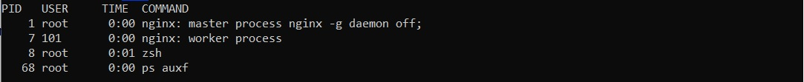
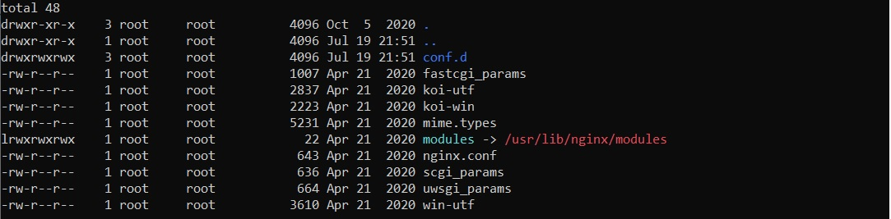
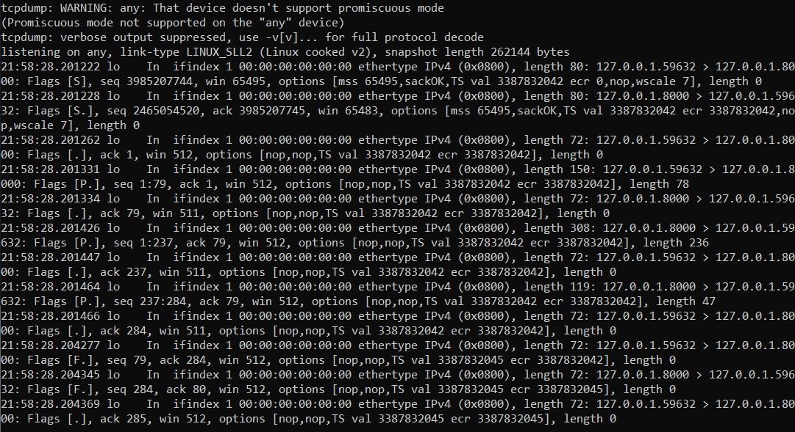
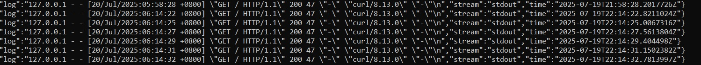

# Диагностика и отладка в Kubernetes

Для выполнения использовался кластер Kubernetes и утилита kubectl, для которой приведены использованные команды.

## Задача
- Создать pod с distroless образом kyos0109/nginx-distroless
- С помощью команды kubectl debug создать эфемерный контейнер длā отладки pod. Отладочный контейнер должен иметь доступ к пространству имен pid для основного контейнера pod.
- Настроить и проверить доступ к файловой системе отлаживаемого контейнера из эфемерного - вывод команды ls –la /etc/nginx должен показывать структуру соответствующего каталога.
- Запустить в отладочном контейнере команду tcpdump -nn -i any -e port 8000 и выполнить несколько сетевых обращений к nginx в отлаживаемом pod, убедиться что tcpdump отображает сетевые пакеты этих подключений.
- С помощью kubectl debug создать отладочный под для ноды, на которой запущен pod с distroless nginx.
- Получить доступ к файловой системе ноды, и затем доступ к логам pod с distrolles nginx.

## Выполнение
### Создание namespace и pod с distrolles nginx
*kubectl apply -f ./manifests/namespace.yaml*

*kubectl apply -f ./manifests/configmap.yaml*

*kubectl apply -f ./manifests/pod.yaml*

### Создание эфемерного контейнера
*kubectl debug -it -c webserver-debugger --target=webserver --share-processes --image=nicolaka/netshoot  kubernetes-debug -n homework*

*ps auxf*

*ls -la /proc/1/root/etc/nginx/*

### Проверка tcpdump

*tcpdump -nn -i any -e port 8000*

Выполнить сетевые обращения к pod:

*kubectl port-forward pod/kubernetes-debug 8080:8000 -n homework*

*curl http://localhost:8080*

### Создание отладочного pod для ноды

*kubectl debug node/docker-desktop -it --image=nicolaka/netshoot*

### Чтение логов pod с distrolles nginx

*chroot /host*

*cat /var/log/pods/homework_kubernetes-debug_e559e54f-0eae-4439-8d64-8d1481bbdf72/webserver/0.log*

